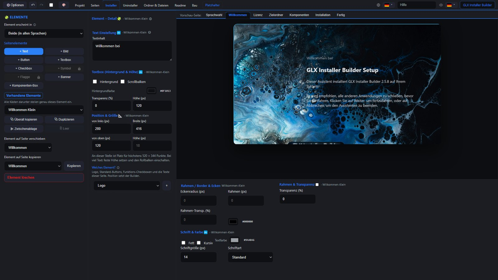
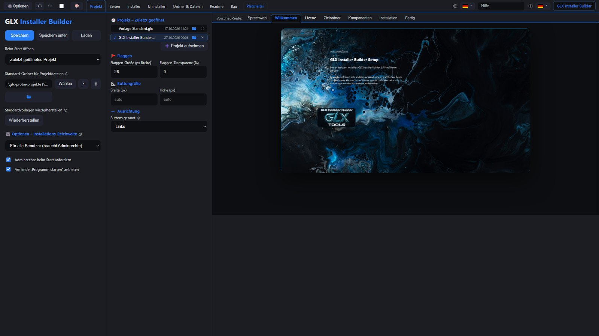
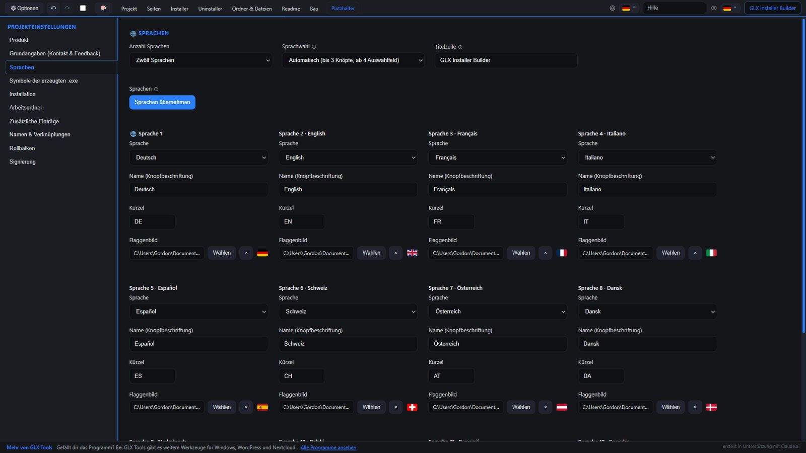
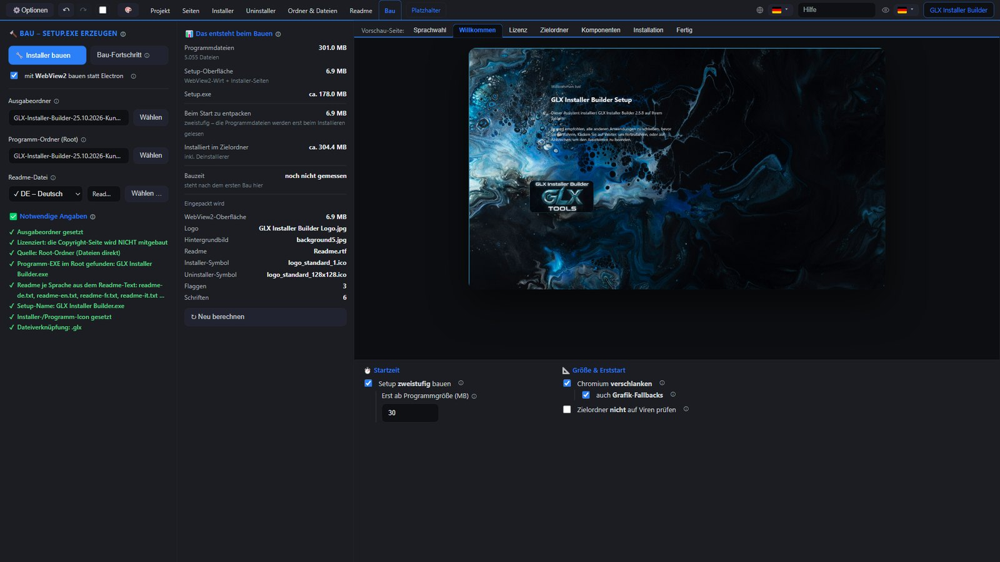
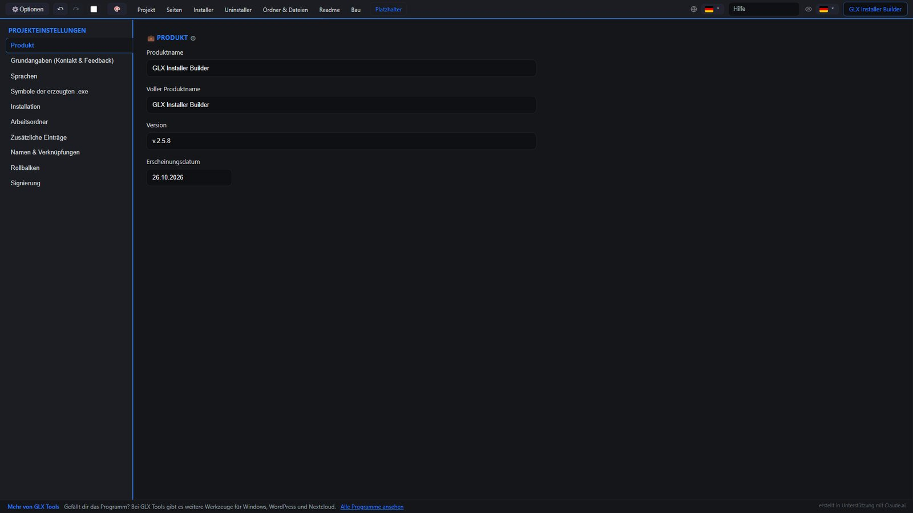
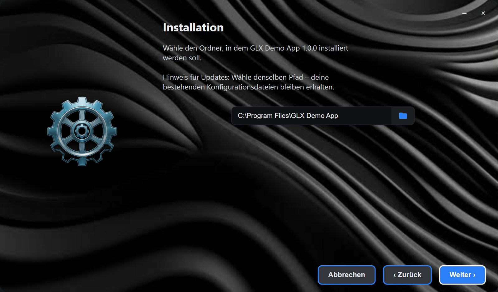

🌍 Languages: [🇺🇸 English](README.md) | [🇩🇪 Deutsch](README.de.md)

# 📦 GLX Installer Builder

Unique Selling Points:
- 12-language installation wizard & 12-language setup preview window
- Template files (.glx) provided in all 12 languages
- Readme template files provided in all 12 languages
- Custom, borderless window design with visual effects
- Option to define and customize your own logo
- Design the installer and uninstaller exactly as you wish

### Turn your program folder into a finished Setup.exe – without writing a line of code 🛠️

*Windows setups with a real uninstaller, twelve languages and your own design. Everything set up with the mouse.* ⚡

---

## ⬇️ Download

👉 **[Latest version in the Releases](../../releases/latest)** – download the setup, install it, try it free for 7 days.

---

## 📖 About GLX Installer Builder

### From program folder to finished Setup.exe

GLX Installer Builder turns your program folder into a finished Setup.exe without writing a line of code. Pick a ready-made template, add your files, choose install folder, shortcuts and file associations, and build a single-file setup with a real uninstaller that appears in Apps & Features.

### Twelve languages

Every setup speaks twelve fully translated languages, chosen with a flag, and shows your licence text and a readme with a built-in editor and sample texts.

### Designed your way

Colours, background images, progress bar, window buttons, banners and your logo. Switch pages on, reorder them or add your own, and place elements freely with the mouse. A live preview shows every installer page while you edit.

### Lean and fair

Setups stay lean because no extra runtime is packed in. The developer licence adds update and repair modes. Pay once, no fee per setup and no reference to us in your setup. Free 7-day trial.

---

## 📸 Overview & Screenshots

### 1️⃣ Page editor with live preview

### 2️⃣ Project settings

### 3️⃣ Up to twelve setup languages

### 4️⃣ Build with checklist

### 5️⃣ Settings

### 6️⃣ The finished setup

---

## ✨ Features

- 📦 **One setup, one file:** Your customer downloads a single EXE – no folder, no archive.
- 🧹 **A real uninstaller:** Listed in “Apps & Features”, removes program folder, shortcuts, Start menu entry and registry. Your customer's data stays unless they tick the box themselves.
- 🌐 **Twelve languages, fully translated:** German, English, French, Italian, Spanish, Danish, Swedish, Dutch, Polish, Russian, Austrian, Swiss – chosen with a flag.
- 🎨 **Your design:** Colors, background image, progress bar, window buttons, banner per page, your logo. Every button configurable on its own, including its hover state.
- 🧩 **You decide what is shown:** Switch pages on and off, reorder them, add your own. Place texts, images, buttons, text boxes and checkboxes freely with the mouse.
- 📝 **Readme editor per language:** With formatting and a ready-made sample text in all twelve languages. Product name, version, date, e-mail and website are filled in automatically.
- 📁 **You decide what gets installed:** Files, target folder, shortcuts (desktop, Start menu, autostart), file associations with your icon.
- 🪶 **Lean setups:** No 140 MB runtime inside every setup – the builder uses what Windows already has.
- 🎁 **Extensions:** Icon library with more than 476 icons, flag library with 249 country flags.
- 💶 **Pay once:** No fee per setup, no limit, and no reference to us in your finished setup.

### 🧑‍💻 Developer license

Everything from the standard version, plus:

- 🔄 **Update mode:** The setup detects an existing installation and installs the new version over it – settings are kept.
- 🔧 **Repair mode:** “Modify” in “Apps & Features” restores all program files without touching customer data.
- 🎁 **All extensions included** for the term of the license.

---

## 🧩 Requirements

- 🪟 Windows 10 or Windows 11 (64-bit)

---

## 🚀 Installation

1. Download `GLX Installer Builder.exe` from the **[Releases](../../releases/latest)**.
2. Run it and follow the instructions.
3. The builder runs as a 7-day trial. After that, activate a license via the website.

---

## 🔗 More about this program

👉 **[GLX Installer Builder on glx-tools.de](https://glx-tools.de/product/glx-installer-builder/)** – description, licenses and purchase.

---

## 📄 License

Proprietary software. © GLX Tools – all rights reserved.
This repository contains no source code, only the description and downloads.

---

Made with ❤️ by **Dreamdancer100**

